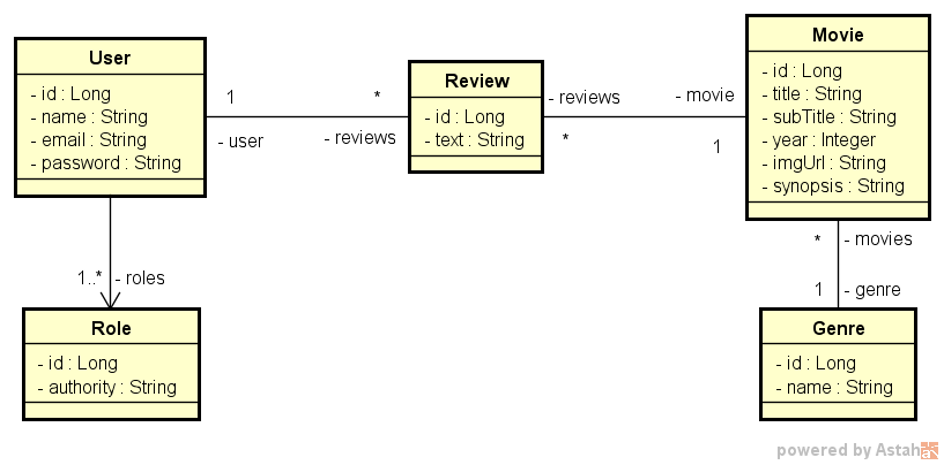

# Desafio: Movieflix Casos de Uso

## Descrição

Este projeto consiste na implementação dos casos de uso de um sistema de catálogo de filmes, o **Movieflix**, permitindo que usuários consultem filmes e registrem avaliações. As principais funcionalidades são:

- **Listar filmes:** apresenta os gêneros disponíveis e uma listagem paginada de filmes, com filtro opcional por gênero.
- **Visualizar detalhes do filme:** apresenta as informações completas de um filme e suas avaliações, permitindo que usuários membros registrem novas avaliações.

O objetivo é implementar as funcionalidades necessárias para que todos os testes do projeto base passem.

## Modelo conceitual

O modelo é composto pelas seguintes entidades:

- **User:** id, nome, email e senha. Possui um ou mais perfis (`Role`) e pode realizar várias avaliações;
- **Role:** id e autoridade (perfil de acesso);
- **Movie:** id, título, subtítulo, ano, URL da imagem e sinopse. Pertence a um gênero e pode ter várias avaliações;
- **Genre:** id e nome. Pode estar associado a vários filmes;
- **Review:** id e texto. Associa um usuário a um filme.

## Especificações

### Listar filmes

A listagem deve permitir que o usuário consulte os filmes do catálogo, aplicando opcionalmente um filtro por gênero.

#### Atores

Usuário **visitante** ou **membro**.

#### Entrada

O usuário poderá informar, opcionalmente:

- Um gênero.

#### Saída

O sistema deverá retornar:

- Uma listagem com os **nomes de todos os gêneros**;
- Uma **listagem paginada** de filmes contendo, para cada filme:
    - Título;
    - Subtítulo;
    - Ano;
    - Imagem.

#### Regras

- A listagem de filmes deve ser **ordenada alfabeticamente por título**.
- Caso um gênero seja selecionado, a listagem deverá ser atualizada, restringindo-se **somente aos filmes do gênero selecionado**.

---

### Visualizar detalhes do filme

Os detalhes devem apresentar as informações completas de um filme, bem como as avaliações realizadas pelos usuários.

#### Atores

Usuário **visitante** ou **membro** (o registro de avaliação é exclusivo do usuário **membro**).

#### Entrada

O usuário poderá informar:

- O filme a ser visualizado;
- Opcionalmente, um texto para avaliação do filme (somente usuário **membro**).

#### Saída

O sistema deverá retornar:

- Título, subtítulo, ano, imagem e sinopse do filme;
- Uma listagem das avaliações do filme contendo, para cada avaliação:
    - Texto da avaliação;
    - Nome do usuário que fez a avaliação.

Após o registro de uma avaliação, o sistema deverá apresentar os dados atualizados, já incluindo a avaliação feita pelo usuário.

#### Regras

- Apenas usuários com perfil **membro** podem registrar avaliações.

#### Exceções

- **Texto vazio:** caso o texto da avaliação seja vazio, o sistema deverá apresentar uma mensagem informando que não é permitido texto vazio na avaliação.

## Critério de aprovação

O projeto deve passar em, no mínimo, **12 dos 15 testes** automatizados fornecidos.

## Tecnologias

Este projeto utiliza tecnologias do ecossistema Java e Spring para implementação das APIs, controle de acesso e consultas ao banco de dados.

## Referência

Desafio proposto pela [DevSuperior](https://devsuperior.com.br/).

---

**Todos os direitos reservados à DevSuperior.**